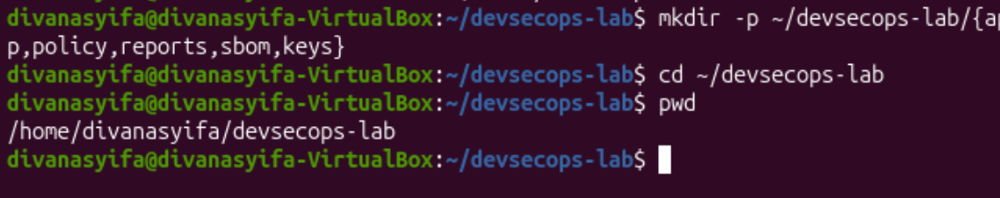
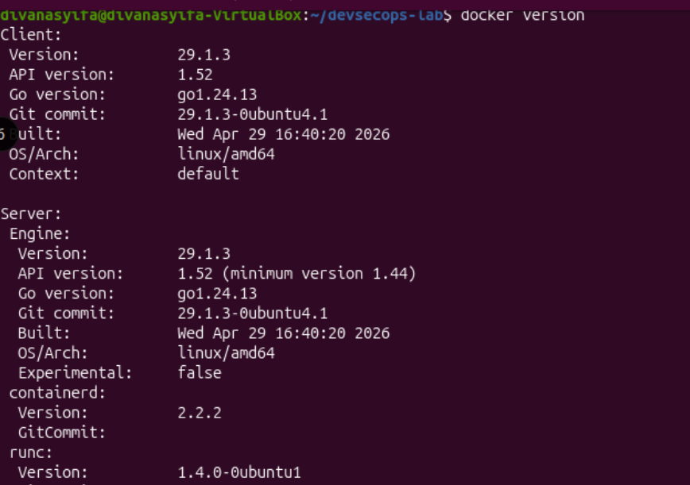
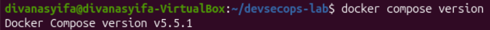
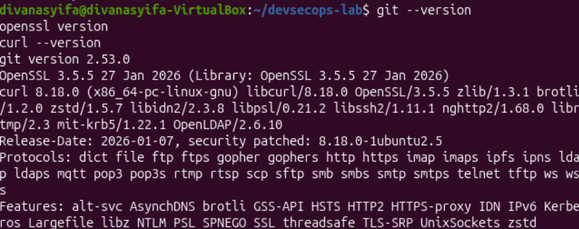
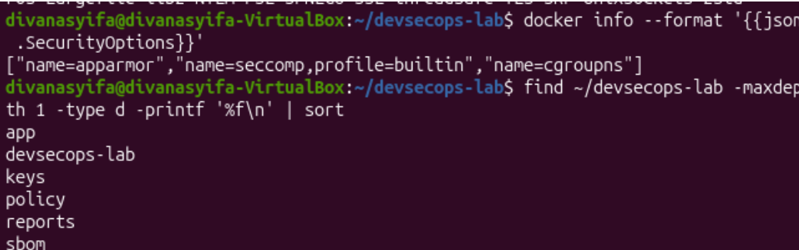

# LAPORAN PRAKTIKUM DEVSECOPS
# BAB 1 – FONDASI DAN PERSIAPAN LINGKUNGAN DEVSECOPS

## 1. Tujuan

Praktikum Bab 1 bertujuan untuk mempersiapkan lingkungan kerja yang akan digunakan dalam kegiatan praktikum DevSecOps. Persiapan ini dilakukan dengan memastikan tools utama seperti Docker, Docker Compose, Git, OpenSSL, dan cURL telah tersedia dan dapat digunakan pada sistem.

Selain itu, praktikum ini bertujuan untuk mengenali konfigurasi keamanan Docker melalui pemeriksaan SecurityOptions. Pemeriksaan tersebut dilakukan untuk mengetahui mekanisme keamanan yang tersedia pada Docker serta menjadikannya sebagai baseline atau kondisi awal sebelum melaksanakan praktikum pada bab berikutnya.

Secara khusus, tujuan praktikum ini adalah:

1. Membuat struktur direktori kerja untuk menyimpan source code aplikasi, konfigurasi keamanan, laporan, SBOM, dan file kunci.
2. Memeriksa instalasi dan versi Docker serta Docker Compose.
3. Memastikan tools pendukung seperti Git, OpenSSL, dan cURL tersedia pada sistem.
4. Memeriksa konfigurasi keamanan Docker melalui SecurityOptions.
5. Memahami pentingnya persiapan lingkungan dalam penerapan konsep DevSecOps.
6. Mendokumentasikan kondisi awal lingkungan praktikum agar eksperimen berikutnya dapat dilakukan secara konsisten dan dapat direproduksi.

## 2. Dasar Teori

### 2.1 Pengertian DevSecOps

DevSecOps merupakan pendekatan pengembangan dan pengoperasian perangkat lunak yang mengintegrasikan aspek keamanan ke dalam seluruh tahapan siklus pengembangan perangkat lunak. DevSecOps berasal dari pengembangan konsep DevOps dengan menambahkan keamanan sebagai bagian yang tidak terpisahkan dari proses pengembangan, pengujian, deployment, hingga pemantauan aplikasi.

Dalam penerapannya, keamanan tidak hanya menjadi tanggung jawab tim keamanan, tetapi juga melibatkan developer, tim operasional, dan pihak lain yang terlibat dalam pengembangan aplikasi.

Tujuan utama DevSecOps adalah menghasilkan perangkat lunak yang tidak hanya memiliki kualitas dan performa yang baik, tetapi juga aman serta mampu mengurangi risiko keamanan sejak tahap awal pengembangan.

### 2.2 Hubungan DevOps dan DevSecOps

DevOps merupakan pendekatan yang menggabungkan aktivitas development dan operations untuk mempercepat proses pengembangan serta pengiriman perangkat lunak. DevOps menggunakan otomatisasi, kolaborasi, dan continuous integration serta continuous delivery (CI/CD).

DevSecOps merupakan pengembangan dari pendekatan tersebut dengan mengintegrasikan kontrol keamanan ke dalam setiap tahapan proses.

Perbedaan keduanya dapat dijelaskan sebagai berikut:

| Aspek | DevOps | DevSecOps |
|---|---|---|
| Tujuan | Mempercepat delivery dan meningkatkan reliabilitas | Mempercepat delivery dengan memperhatikan keamanan |
| Keamanan | Dapat dilakukan melalui pemeriksaan terpisah | Terintegrasi sepanjang siklus pengembangan |
| Pengujian | Berfokus pada kualitas dan fungsionalitas | Mencakup kualitas dan pengujian keamanan |
| Tanggung Jawab | Development dan operations | Development, security, operations, dan platform |
| Hasil | Aplikasi dan konfigurasi | Aplikasi, hasil pemeriksaan, SBOM, dan evidence keamanan |

Dengan demikian, DevSecOps tidak hanya berkaitan dengan penggunaan tools keamanan, tetapi juga perubahan proses kerja, budaya kolaborasi, dan pengelolaan risiko.

### 2.3 Konsep Shift-Left dan Shift-Right Security

Shift-left merupakan pendekatan yang menempatkan pemeriksaan keamanan sedini mungkin dalam proses pengembangan perangkat lunak. Tujuannya adalah menemukan dan memperbaiki kerentanan sebelum aplikasi masuk ke tahap deployment.

Contoh penerapan shift-left adalah pemeriksaan source code, secret scanning, linting Dockerfile, dan pengujian keamanan pada tahap pengembangan.

Sementara itu, shift-right merupakan pendekatan keamanan yang dilakukan setelah aplikasi dijalankan atau berada di lingkungan operasional. Pendekatan ini bertujuan untuk mendeteksi ancaman dan masalah keamanan yang mungkin tidak ditemukan pada tahap pengembangan.

Contoh penerapan shift-right adalah monitoring aplikasi, runtime detection, pengujian keamanan pada staging, dan pemantauan aktivitas sistem.

Kedua pendekatan tersebut saling melengkapi untuk memastikan keamanan aplikasi tetap terjaga sepanjang siklus hidup perangkat lunak.

### 2.4 Docker dan Docker Compose

Docker merupakan platform yang digunakan untuk membuat, menjalankan, dan mengelola aplikasi dalam bentuk container. Container memungkinkan aplikasi beserta dependensinya dikemas dalam satu lingkungan sehingga dapat dijalankan secara lebih konsisten pada berbagai sistem.

Dalam DevSecOps, Docker membantu proses pengembangan dan pengujian aplikasi karena lingkungan aplikasi dapat dibuat secara terisolasi dan lebih mudah direproduksi.

Docker Compose merupakan alat untuk mengelola beberapa container dalam satu konfigurasi. Dengan Docker Compose, beberapa layanan aplikasi dapat dijalankan dan dikelola menggunakan satu file konfigurasi.

Pemeriksaan Docker dan Docker Compose diperlukan untuk memastikan lingkungan praktikum siap digunakan dalam kegiatan pengembangan dan pengujian aplikasi berbasis container.

### 2.5 Tools Pendukung DevSecOps

Beberapa tools pendukung yang digunakan dalam praktikum ini memiliki fungsi sebagai berikut:

- **Git:** Digunakan untuk mengelola source code, mencatat perubahan, dan melakukan version control.
- **OpenSSL:** Digunakan untuk kebutuhan kriptografi, pembuatan kunci, serta pengelolaan sertifikat digital.
- **cURL:** Digunakan untuk melakukan komunikasi melalui protokol HTTP/HTTPS dan menguji endpoint aplikasi atau API.
- **Docker:** Digunakan untuk menjalankan aplikasi dalam container.
- **Docker Compose:** Digunakan untuk mengelola beberapa container dalam satu lingkungan aplikasi.

Ketersediaan tools tersebut menjadi salah satu persyaratan dasar agar proses praktikum DevSecOps dapat berjalan dengan baik.

### 2.6 Konfigurasi Keamanan Docker

Docker memiliki beberapa mekanisme keamanan yang digunakan untuk membatasi akses dan aktivitas container. Mekanisme tersebut dapat melibatkan Linux namespaces, cgroups, capabilities, seccomp, AppArmor, maupun SELinux, bergantung pada konfigurasi sistem.

Pemeriksaan SecurityOptions dilakukan untuk mengetahui mekanisme keamanan yang dilaporkan oleh Docker daemon pada lingkungan praktikum.

Informasi ini dapat digunakan sebagai baseline konfigurasi keamanan. Namun, hasil pemeriksaan SecurityOptions tidak secara otomatis membuktikan bahwa seluruh container telah dikonfigurasi dengan aman.

Oleh karena itu, pemeriksaan tersebut perlu dipahami sebagai langkah awal dalam proses evaluasi keamanan lingkungan Docker.

## 3. Alat dan Bahan

Alat dan bahan yang digunakan dalam praktikum Bab 1 adalah sebagai berikut:

| No. | Alat/Bahan | Fungsi |
|---|---|---|
| 1 | Sistem Operasi Linux | Lingkungan utama untuk menjalankan praktikum |
| 2 | Docker Engine | Menjalankan aplikasi berbasis container |
| 3 | Docker Compose | Mengelola beberapa container |
| 4 | Git | Mengelola source code dan version control |
| 5 | OpenSSL | Mendukung kebutuhan kriptografi |
| 6 | cURL | Menguji komunikasi HTTP/API |
| 7 | Terminal Linux | Menjalankan perintah praktikum |

## 4. Langkah-Langkah Praktikum

### 4.1 Persiapan Lingkungan Kerja

Langkah pertama adalah membuat direktori utama yang digunakan sebagai tempat penyimpanan seluruh file praktikum DevSecOps.

Direktori utama yang digunakan adalah `~/devsecops-lab`. Di dalam direktori tersebut dibuat lima subdirektori, yaitu:

- `app`: Menyimpan source code atau file aplikasi.
- `policy`: Menyimpan konfigurasi kebijakan keamanan.
- `reports`: Menyimpan laporan hasil praktikum dan pengujian.
- `sbom`: Menyimpan Software Bill of Materials.
- `keys`: Menyimpan file yang berkaitan dengan kunci dan kebutuhan kriptografi.

Struktur direktori dibuat menggunakan perintah berikut:

```bash
mkdir -p ~/devsecops-lab/{app,policy,reports,sbom,keys}
```

Setelah direktori dibuat, masuk ke direktori utama menggunakan perintah:

```bash
cd ~/devsecops-lab
```

Untuk memastikan lokasi direktori kerja, jalankan:

```bash
pwd
```

Hasil yang diperoleh:



```text
/home/divanasyifa/devsecops-lab
```

Hasil tersebut menunjukkan bahwa direktori kerja telah berhasil dibuat dan terminal berada di dalam direktori utama praktikum.

Struktur direktori yang diharapkan adalah:

```text
devsecops-lab/
├── app/
├── policy/
├── reports/
├── sbom/
└── keys/
```

Struktur ini dibuat agar setiap file praktikum tersimpan secara terorganisasi dan mudah ditemukan ketika dibutuhkan pada tahapan berikutnya.

### 4.2 Pemeriksaan Docker

Langkah berikutnya adalah memeriksa apakah Docker telah terpasang dan dapat digunakan pada sistem.

Docker merupakan salah satu komponen utama dalam praktikum karena digunakan untuk menjalankan aplikasi berbasis container. Pemeriksaan dilakukan dengan menjalankan perintah:

```bash
docker version
```


Perintah tersebut digunakan untuk menampilkan informasi versi Docker Client dan Docker Server.

Apabila Docker telah terpasang dan daemon dapat diakses, informasi versi akan ditampilkan pada terminal.

Pemeriksaan ini penting untuk memastikan bahwa Docker dapat digunakan sebelum melanjutkan kegiatan praktikum yang membutuhkan container.

### 4.3 Pemeriksaan Docker Compose

Setelah Docker diperiksa, langkah selanjutnya adalah memeriksa ketersediaan Docker Compose.

Docker Compose digunakan untuk mengatur dan menjalankan beberapa container melalui satu konfigurasi. Pemeriksaan dilakukan dengan perintah:

```bash
docker compose version
```


Hasil pemeriksaan menunjukkan bahwa Docker Compose V2 tersedia pada lingkungan praktikum.

Penggunaan perintah `docker compose` menunjukkan bahwa Docker Compose dijalankan sebagai plugin Docker dengan format perintah yang terintegrasi.

Dengan tersedianya Docker Compose, lingkungan praktikum dapat digunakan untuk menjalankan aplikasi yang membutuhkan lebih dari satu layanan container.

### 4.4 Pemeriksaan Tools Pendukung

Pada tahap ini dilakukan pemeriksaan terhadap tools pendukung yang diperlukan dalam kegiatan DevSecOps, yaitu Git, OpenSSL, dan cURL.

**a. Pemeriksaan Git**

Git digunakan untuk mengelola source code dan mencatat perubahan pada file proyek. Pemeriksaan dilakukan menggunakan perintah:

```bash
git --version
```


Perintah tersebut digunakan untuk memastikan bahwa Git telah terpasang dan dapat dijalankan.

**b. Pemeriksaan OpenSSL**

OpenSSL digunakan untuk mendukung kebutuhan kriptografi, seperti pembuatan kunci, pengelolaan sertifikat digital, dan proses enkripsi.

Pemeriksaan dilakukan menggunakan perintah:

```bash
openssl version
```

Apabila OpenSSL tersedia, terminal akan menampilkan informasi versi yang digunakan.

**c. Pemeriksaan cURL**

cURL digunakan untuk melakukan komunikasi melalui protokol HTTP dan HTTPS. Tools ini juga dapat digunakan untuk menguji endpoint aplikasi atau API.

Pemeriksaan dilakukan menggunakan perintah:

```bash
curl --version
```

Hasil pemeriksaan digunakan untuk memastikan bahwa cURL telah tersedia dan dapat digunakan.

Berdasarkan pemeriksaan yang dilakukan, Git, OpenSSL, dan cURL tersedia pada lingkungan praktikum sehingga dapat digunakan sebagai tools pendukung pada tahap berikutnya.

### 4.5 Pemeriksaan Konfigurasi Keamanan Docker

Tahap selanjutnya adalah memeriksa konfigurasi keamanan Docker melalui informasi SecurityOptions.

Pemeriksaan ini dilakukan untuk mengetahui mekanisme keamanan yang dilaporkan oleh Docker daemon pada sistem.

Perintah yang digunakan adalah:

```bash
docker info --format '{{json .SecurityOptions}}'
```



Perintah tersebut menggunakan `docker info` untuk mengambil informasi konfigurasi Docker. Bagian `--format` digunakan untuk menampilkan informasi SecurityOptions dalam format JSON.

SecurityOptions dapat menampilkan informasi mengenai mekanisme keamanan yang aktif atau dilaporkan oleh Docker, misalnya terkait seccomp, AppArmor, atau mekanisme keamanan lainnya sesuai konfigurasi sistem.

Hasil pemeriksaan ini kemudian digunakan sebagai dokumentasi kondisi awal keamanan Docker.

Penting untuk diperhatikan bahwa hasil SecurityOptions dapat berbeda pada setiap sistem. Perbedaan tersebut dapat dipengaruhi oleh sistem operasi, konfigurasi kernel Linux, dan pengaturan Docker daemon.

Oleh karena itu, hasil pemeriksaan harus dicatat sesuai keluaran yang benar-benar muncul pada terminal.

## 5. Hasil Praktikum dan Verifikasi

Berdasarkan langkah-langkah yang telah dilakukan, diperoleh hasil pemeriksaan lingkungan praktikum sebagai berikut.

### 5.1 Hasil Pembuatan Direktori

Pembuatan direktori utama dan subdirektori berhasil dilakukan menggunakan perintah `mkdir -p`.

Direktori yang berhasil disiapkan terdiri dari:

| No. | Nama Direktori | Keterangan |
|---|---|---|
| 1 | app | Tempat penyimpanan source code aplikasi |
| 2 | policy | Tempat penyimpanan kebijakan keamanan |
| 3 | reports | Tempat penyimpanan laporan praktikum |
| 4 | sbom | Tempat penyimpanan Software Bill of Materials |
| 5 | keys | Tempat penyimpanan file kunci |

Hasil perintah `pwd` menunjukkan lokasi direktori kerja:

```text
/home/divanasyifa/devsecops-lab
```

Dengan demikian, direktori kerja praktikum telah berhasil disiapkan.

### 5.2 Hasil Pemeriksaan Docker dan Docker Compose

Pemeriksaan Docker dilakukan menggunakan perintah `docker version`, sedangkan Docker Compose diperiksa menggunakan perintah `docker compose version`.

Hasil pemeriksaan menunjukkan bahwa Docker tersedia dan Docker Compose V2 dapat digunakan pada lingkungan praktikum.

Hal tersebut menunjukkan bahwa komponen utama untuk menjalankan container telah tersedia.

### 5.3 Hasil Pemeriksaan Tools Pendukung

Pemeriksaan terhadap Git, OpenSSL, dan cURL dilakukan menggunakan perintah versi masing-masing.

| No. | Tools | Perintah Pemeriksaan | Hasil |
|---|---|---|---|
| 1 | Git | `git --version` | Tersedia |
| 2 | OpenSSL | `openssl version` | Tersedia |
| 3 | cURL | `curl --version` | Tersedia |

Berdasarkan hasil pemeriksaan, seluruh tools pendukung tersebut telah tersedia pada sistem dan dapat digunakan untuk menunjang praktikum DevSecOps.

### 5.4 Hasil Pemeriksaan SecurityOptions

Pemeriksaan SecurityOptions dilakukan menggunakan perintah:

```bash
docker info --format '{{json .SecurityOptions}}'
```

Perintah tersebut digunakan untuk memperoleh informasi mengenai konfigurasi keamanan yang dilaporkan oleh Docker daemon.

Hasil pemeriksaan ini menjadi dokumentasi awal kondisi keamanan Docker sebelum dilakukan konfigurasi atau pengujian keamanan lebih lanjut.

Informasi SecurityOptions perlu disimpan agar dapat dibandingkan dengan hasil pemeriksaan pada praktikum berikutnya.

### 5.5 Ringkasan Hasil Praktikum

Berdasarkan seluruh pemeriksaan yang telah dilakukan, ringkasan hasil praktikum Bab 1 adalah sebagai berikut:

| No. | Kegiatan | Hasil |
|---|---|---|
| 1 | Pembuatan direktori kerja | Berhasil |
| 2 | Pemeriksaan Docker | Tersedia |
| 3 | Pemeriksaan Docker Compose | Docker Compose V2 tersedia |
| 4 | Pemeriksaan Git | Tersedia |
| 5 | Pemeriksaan OpenSSL | Tersedia |
| 6 | Pemeriksaan cURL | Tersedia |
| 7 | Pemeriksaan SecurityOptions | Informasi konfigurasi berhasil diperiksa |

Secara keseluruhan, lingkungan praktikum telah dipersiapkan dan komponen utama yang dibutuhkan untuk melanjutkan kegiatan DevSecOps telah tersedia.

## 6. Analisis

Berdasarkan hasil praktikum Bab 1, dapat diketahui bahwa persiapan lingkungan merupakan tahap penting sebelum melakukan implementasi DevSecOps.

Pembuatan direktori kerja bertujuan untuk mengatur penyimpanan file agar lebih terstruktur. Pemisahan direktori aplikasi, kebijakan keamanan, laporan, SBOM, dan kunci dapat mempermudah pengelolaan data selama proses praktikum berlangsung.

Pemeriksaan Docker menunjukkan bahwa lingkungan telah memiliki komponen utama untuk menjalankan aplikasi dalam container. Docker membantu menyediakan lingkungan aplikasi yang lebih konsisten dan dapat digunakan untuk melakukan pengujian secara terisolasi.

Selain itu, ketersediaan Docker Compose V2 memberikan kemudahan dalam pengelolaan beberapa container sekaligus. Hal ini penting karena aplikasi modern sering kali terdiri dari beberapa layanan yang saling berhubungan.

Pemeriksaan Git, OpenSSL, dan cURL juga menunjukkan bahwa tools pendukung telah tersedia. Git dapat digunakan untuk mengelola perubahan source code, OpenSSL mendukung kebutuhan kriptografi, sedangkan cURL dapat digunakan untuk melakukan pengujian komunikasi HTTP maupun HTTPS.

Pemeriksaan SecurityOptions memberikan gambaran awal mengenai mekanisme keamanan yang dilaporkan oleh Docker daemon. Informasi tersebut dapat dijadikan baseline untuk memahami kondisi konfigurasi keamanan sebelum dilakukan pengujian lebih lanjut.

Namun, SecurityOptions bukan satu-satunya indikator keamanan Docker. Keamanan container juga dipengaruhi oleh konfigurasi ketika container dijalankan, seperti penggunaan user non-root, pembatasan capabilities, pengaturan jaringan, penggunaan read-only filesystem, serta pembatasan sumber daya.

Dalam penerapan DevSecOps, seluruh hasil pemeriksaan sebaiknya didokumentasikan sebagai evidence atau bukti pelaksanaan kontrol keamanan. Dokumentasi tersebut dapat digunakan untuk melakukan evaluasi dan membandingkan kondisi lingkungan pada tahap praktikum selanjutnya.

Dengan demikian, persiapan lingkungan tidak hanya bertujuan memastikan tools tersedia, tetapi juga membangun dasar pengelolaan keamanan yang terstruktur, terukur, dan dapat direproduksi.

## 7. Kesimpulan

Berdasarkan praktikum Bab 1 yang telah dilakukan, dapat disimpulkan bahwa lingkungan kerja untuk kegiatan DevSecOps berhasil dipersiapkan.

Pembuatan direktori utama beserta subdirektorinya telah dilakukan untuk mengorganisasi file aplikasi, konfigurasi keamanan, laporan, SBOM, dan kebutuhan kriptografi.

Pemeriksaan terhadap Docker dan Docker Compose menunjukkan bahwa komponen utama untuk menjalankan aplikasi berbasis container telah tersedia. Selain itu, Git, OpenSSL, dan cURL juga telah diperiksa dan tersedia sebagai tools pendukung kegiatan praktikum.

Pemeriksaan SecurityOptions memberikan informasi awal mengenai konfigurasi keamanan Docker yang dapat digunakan sebagai baseline untuk evaluasi pada tahap selanjutnya.

Secara keseluruhan, praktikum Bab 1 memberikan pemahaman mengenai pentingnya persiapan lingkungan, ketersediaan tools, pengelolaan direktori, serta dokumentasi konfigurasi keamanan sebagai fondasi penerapan DevSecOps.

Dengan selesainya praktikum ini, lingkungan kerja telah memiliki persiapan dasar untuk melanjutkan kegiatan praktikum pada bab berikutnya.
