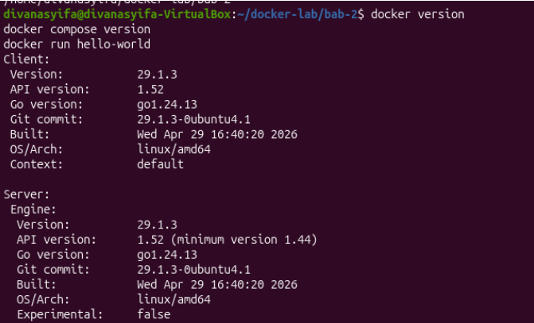
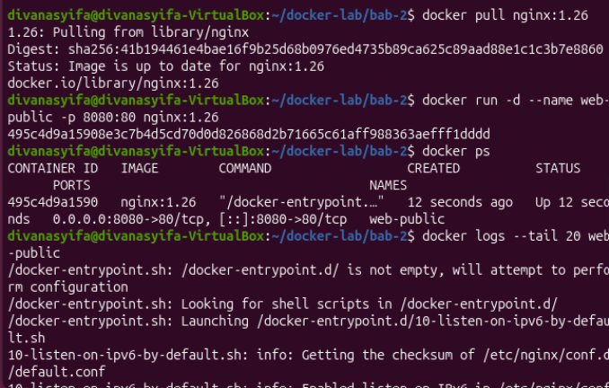
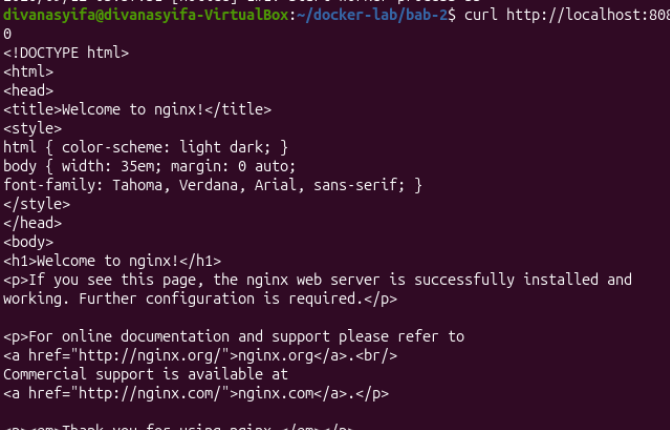
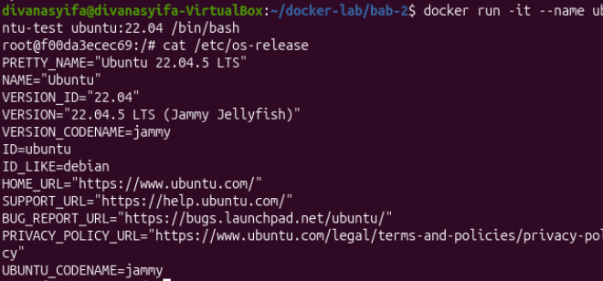

# LAPORAN PRAKTIKUM DEVSECOPS
# BAB 2 – KONSEP CONTAINER DAN INSTALASI DOCKER

## 1. Tujuan Praktikum

Praktikum Bab 2 bertujuan untuk memahami konsep dasar containerization dan penggunaan Docker sebagai platform untuk menjalankan aplikasi dalam container.

Secara khusus, praktikum ini bertujuan untuk:

1. Memahami perbedaan container dan virtual machine.
2. Mengenali komponen Docker, seperti Docker Engine, Docker CLI, image, container, dan registry.
3. Memastikan Docker Engine dan Docker Compose dapat digunakan.
4. Menjalankan container menggunakan image Nginx dan Ubuntu.
5. Memahami penggunaan port mapping untuk mengakses layanan di dalam container.
6. Membuat custom image menggunakan Dockerfile.
7. Memahami aspek keamanan dan pengelolaan container.

## 2. Persiapan Lingkungan

Praktikum dilakukan menggunakan sistem operasi Ubuntu. Sebelum memulai pengujian, dibuat direktori kerja khusus untuk menyimpan file dan konfigurasi praktikum Bab 2.

Perintah yang digunakan:

```bash
mkdir -p ~/docker-lab/bab2
cd ~/docker-lab/bab2
```

Selanjutnya dilakukan pemeriksaan Docker Engine dan Docker Compose menggunakan perintah:

```bash
docker version
docker compose version
```


Untuk memastikan Docker dapat menjalankan container, dilakukan pengujian menggunakan:

```bash
docker run hello-world
```

Hasil pemeriksaan menunjukkan bahwa Docker dapat digunakan dan container `hello-world` berhasil dijalankan. Hal ini menunjukkan bahwa Docker CLI dapat berkomunikasi dengan Docker Engine dan menjalankan container.

**Gambar 1. Pemeriksaan Docker dan Docker Compose**



## 3. Menjalankan Container Nginx

Pada tahap ini dilakukan pengambilan image Nginx versi 1.26 dari registry menggunakan perintah:

```bash
docker pull nginx:1.26
```

Setelah image berhasil diunduh, container dijalankan dengan nama `web-public`. Port 80 pada container dipetakan ke port 8080 pada host menggunakan opsi `-p`.

```bash
docker run -d --name web-public -p 8080:80 nginx:1.26
```

Untuk memeriksa container yang sedang berjalan, digunakan perintah:

```bash
docker ps
```

Selanjutnya dilakukan pemeriksaan log container:

```bash
docker logs --tail 20 web-public
```

Pengujian akses layanan dilakukan menggunakan:

```bash
curl http://localhost:8080
```

Hasil pengujian menunjukkan bahwa halaman Nginx dapat diakses melalui port 8080 pada host. Dengan demikian, container Nginx berhasil berjalan dan dapat menerima permintaan HTTP dari host.

**Gambar 2. Status Container Nginx**



**Gambar 3. Hasil Pengujian Akses Nginx**



## 4. Menjalankan Container Ubuntu Interaktif

Selain menjalankan web server, dilakukan percobaan menggunakan image Ubuntu secara interaktif.

Container dijalankan menggunakan perintah:

```bash
docker run -it --name ubuntu-test ubuntu:22.04 /bin/bash
```

Setelah masuk ke shell container, dilakukan pemeriksaan informasi sistem menggunakan:

```bash
cat /etc/os-release
```

Percobaan ini menunjukkan bahwa container Ubuntu dapat digunakan sebagai lingkungan proses yang terisolasi. Pengguna juga dapat berinteraksi langsung dengan shell di dalam container.

Setelah pengujian selesai, keluar dari shell menggunakan perintah `exit`. Container yang sudah tidak digunakan kemudian dihapus menggunakan:

```bash
docker rm -f ubuntu-test
```

Penghapusan dilakukan agar tidak menyisakan container yang tidak diperlukan.

**Gambar 4. Pengujian Container Ubuntu Interaktif**



## 5. Membuat Custom Image dengan Dockerfile

Pada tahap ini dibuat aplikasi web sederhana menggunakan Nginx sebagai base image. File `index.html` digunakan sebagai halaman web, sedangkan Dockerfile berisi instruksi untuk membangun image.

Pertama, dibuat direktori aplikasi:

```bash
mkdir -p ~/docker-lab/custom-web
cd ~/docker-lab/custom-web
```

Kemudian dibuat file `index.html`:

```html
<h1>Docker Lab PENS</h1>
<p>Container berhasil berjalan.</p>
```

Selanjutnya dibuat Dockerfile:

```dockerfile
FROM nginx:1.26-alpine
LABEL maintainer="admin@pens.ac.id"
COPY index.html /usr/share/nginx/html/index.html
EXPOSE 80
CMD ["nginx", "-g", "daemon off;"]
```

Penjelasan instruksi Dockerfile:

- `FROM`: Menentukan base image yang digunakan.
- `LABEL`: Menambahkan metadata pada image.
- `COPY`: Menyalin file HTML ke direktori web Nginx.
- `EXPOSE`: Mendokumentasikan port yang digunakan aplikasi.
- `CMD`: Menentukan perintah utama yang dijalankan ketika container dimulai.

Image kemudian dibangun dengan nama `pens-web:1.0` menggunakan perintah:

```bash
docker build -t pens-web:1.0 .
```

Setelah proses build selesai, container dijalankan menggunakan port 9090 pada host yang dipetakan ke port 80 pada container.

```bash
docker run -d --name pens-app -p 9090:80 pens-web:1.0
```

Pengujian dilakukan menggunakan:

```bash
curl http://localhost:9090
```

Hasil pengujian berhasil menampilkan halaman:

```text
Docker Lab PENS
Container berhasil berjalan.
```

Hal tersebut membuktikan bahwa custom image berhasil dibangun dan dijalankan sebagai container.

## 6. Analisis Hasil Praktikum

Berdasarkan praktikum yang telah dilakukan, Docker dapat digunakan untuk menjalankan aplikasi dalam lingkungan container. Container memiliki karakteristik yang berbeda dari virtual machine. Container berbagi kernel sistem operasi host, sedangkan virtual machine menjalankan guest operating system sendiri. Oleh karena itu, container umumnya lebih ringan dan memiliki waktu startup yang lebih cepat.

Pada pengujian Nginx, port container tidak dapat langsung diakses melalui host tanpa pemetaan port. Opsi `-p 8080:80` digunakan untuk meneruskan akses dari port 8080 pada host menuju port 80 di dalam container.

Hal ini berbeda dengan instruksi `EXPOSE` pada Dockerfile. Instruksi tersebut hanya mendokumentasikan port yang digunakan aplikasi dan tidak secara otomatis mempublikasikan port ke host.

Pembuatan custom image menunjukkan bahwa Dockerfile dapat digunakan untuk membuat lingkungan aplikasi yang konsisten dan dapat dijalankan kembali. Image yang telah dibuat dapat digunakan untuk menjalankan container tanpa harus mengatur aplikasi dari awal.

Dari sisi keamanan, penggunaan container tetap memiliki risiko. Container berbagi kernel host sehingga kesalahan konfigurasi dapat memengaruhi keamanan sistem. Selain itu, penggunaan base image yang tidak diperbarui dapat membawa kerentanan ke dalam aplikasi.

Oleh karena itu, image sebaiknya berasal dari sumber terpercaya, menggunakan versi yang spesifik, tidak menyimpan password atau secret di dalam image, dan menjalankan aplikasi menggunakan user non-root jika memungkinkan.

## 7. Permasalahan, Troubleshooting, dan Rekomendasi

### 7.1 Troubleshooting

Pemeriksaan selama praktikum dilakukan menggunakan status container, log, dan pengujian HTTP.

Perintah yang digunakan untuk membantu proses diagnosis adalah:

```bash
docker ps
docker logs --tail 100 web-public
curl -v http://localhost:8080
docker inspect web-public
```

Apabila container tidak dapat diakses, beberapa hal yang perlu diperiksa adalah:

1. Status container melalui `docker ps`.
2. Kesesuaian pemetaan port host dan port container.
3. Log aplikasi menggunakan `docker logs`.
4. Kemungkinan konflik penggunaan port pada host.
5. Konfigurasi jaringan container.

**Permasalahan yang ditemukan selama praktikum:**

[Tuliskan masalah yang benar-benar kamu alami. Jika tidak ada masalah, tuliskan bahwa seluruh pengujian berjalan sesuai langkah dan tidak ditemukan kendala.]

**Cara diagnosis dan penyelesaian:**

[Tuliskan perintah yang digunakan untuk memeriksa masalah serta tindakan yang dilakukan sampai pengujian berhasil.]

### 7.2 Risiko Keamanan dan Operasional

Beberapa risiko yang berkaitan dengan penggunaan Docker adalah:

- Penggunaan image yang memiliki kerentanan keamanan.
- Container yang dijalankan menggunakan hak akses root tanpa kebutuhan.
- Port layanan yang dipublikasikan tanpa pembatasan akses.
- Penggunaan resource host secara berlebihan.
- Penyimpanan data penting hanya pada writable layer container.

### 7.3 Rekomendasi untuk Lingkungan Production

Jika aplikasi akan digunakan pada lingkungan production-like, beberapa rekomendasi yang dapat diterapkan adalah:

1. Menggunakan base image resmi dan versi yang spesifik.
2. Melakukan pemindaian kerentanan terhadap image sebelum deployment.
3. Menjalankan aplikasi menggunakan user non-root jika memungkinkan.
4. Membatasi port yang dipublikasikan ke jaringan.
5. Mengatur batas penggunaan CPU dan memori container.
6. Menggunakan volume untuk menyimpan data yang harus persisten.
7. Tidak menyimpan password, token, atau secret secara langsung di dalam Dockerfile.

## 8. Kesimpulan

Praktikum Bab 2 memberikan pemahaman mengenai konsep dasar containerization dan penggunaan Docker untuk menjalankan aplikasi.

Docker Engine dan Docker Compose berhasil diperiksa, container Nginx berhasil dijalankan dan diakses melalui port host, serta container Ubuntu berhasil digunakan secara interaktif.

Selain itu, custom image berhasil dibuat menggunakan Dockerfile dan dijalankan sebagai container dengan nama `pens-app`. Pengujian menggunakan cURL menunjukkan bahwa halaman web dapat diakses melalui port 9090 pada host.

Praktikum ini juga menunjukkan pentingnya pengelolaan konfigurasi, port mapping, image, dan keamanan container. Dengan demikian, Docker dapat digunakan untuk menyediakan lingkungan aplikasi yang lebih ringan, konsisten, dan mudah didistribusikan, tetapi tetap membutuhkan pengelolaan keamanan yang baik.


