# BAB 3 — DOCKER NETWORK, VOLUME, BIND MOUNT, TMPFS, DAN COMPOSE

## 1. Langkah Praktikum dan Hasil

### 1.1 Membuat Direktori Praktikum

Langkah pertama adalah membuat direktori untuk menyimpan file praktikum Bab 3.

Perintah yang digunakan:

```bash
mkdir -p ~/docker-lab/bab-3
cd ~/docker-lab/bab-3
```
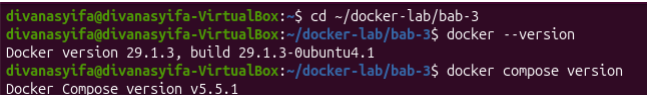

### 1.2 User-Defined Bridge Network

Pada praktikum ini dibuat sebuah user-defined bridge network dengan nama `lab-net` menggunakan subnet `172.20.0.0/16`.

Setelah network berhasil dibuat, dua container berbasis image `nginx:alpine`, yaitu `server-a` dan `server-b`, dijalankan dan dihubungkan ke network tersebut.

Selanjutnya dilakukan pengujian komunikasi dengan perintah:

```bash
docker exec server-a ping -c 3 server-b
```

Pengujian ini bertujuan untuk memastikan bahwa `server-a` dapat menemukan dan berkomunikasi dengan `server-b` menggunakan nama container sebagai hostname melalui DNS internal Docker.

Jika ping berhasil dengan tiga paket diterima, berarti komunikasi antar-container pada user-defined bridge network berjalan dengan baik.

Setelah pengujian selesai, kedua container dihapus menggunakan perintah:

```bash
docker rm -f server-a server-b
```
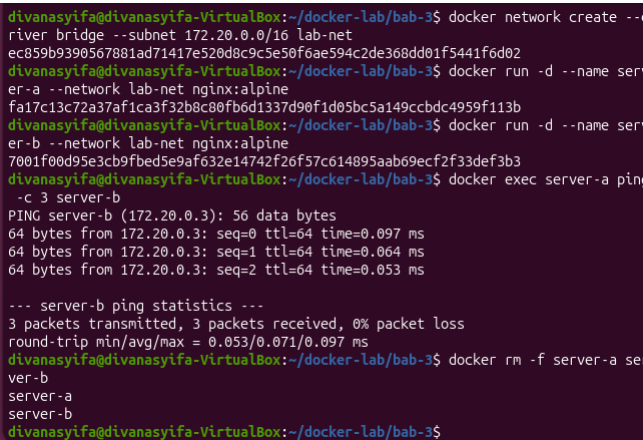

Penghapusan dilakukan agar lingkungan praktikum kembali bersih.

### 1.3 Volume Backup dan Restore

Pada praktikum ini dibuat named volume dengan nama `data-vol` menggunakan perintah:

```bash
docker volume create data-vol
```

Selanjutnya dijalankan container `writer` menggunakan image `alpine:3.20` dan volume `data-vol` di-mount ke direktori `/app/data`.

```bash
docker run -d --name writer -v data-vol:/app/data alpine:3.20 sh -c "while true; do date >> /app/data/log.txt; sleep 5; done"
```

Container tersebut menjalankan proses yang secara berkala menuliskan tanggal ke file `/app/data/log.txt` setiap 5 detik.

Setelah menunggu selama 15 detik, container `writer` dihentikan dan dihapus menggunakan:

```bash
docker rm -f writer
```

Data pada volume kemudian diverifikasi dengan menjalankan container sementara yang me-mount `data-vol` ke `/data` dan membaca isi `/data/log.txt`.

```bash
docker run --rm -v data-vol:/data alpine:3.20 cat /data/log.txt
```

Hasil tersebut membuktikan bahwa data tetap tersimpan pada named volume meskipun container yang membuat data telah dihapus.

Setelah data terverifikasi, dilakukan proses backup dengan me-mount `data-vol` sebagai `/source` dalam mode read-only dan direktori kerja host sebagai `/backup`.

```bash
docker run --rm -v data-vol:/source:ro -v $(pwd):/backup alpine:3.20 tar czf /backup/data-vol-backup.tar.gz -C /source .
```

Perintah `tar czf` digunakan untuk mengarsipkan seluruh isi volume menjadi file `data-vol-backup.tar.gz`.

Dengan demikian, praktikum menunjukkan bahwa named volume dapat digunakan untuk menyimpan data secara persisten dan datanya dapat dibuat menjadi file backup untuk kebutuhan pemulihan.

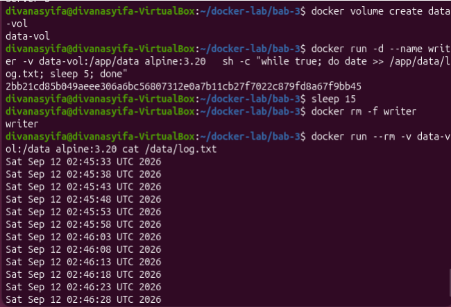

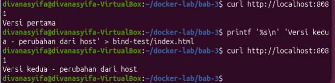

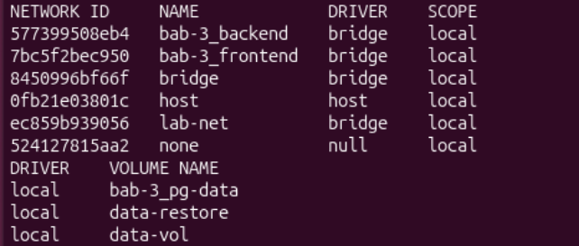

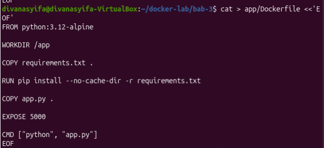

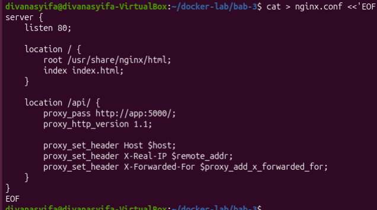

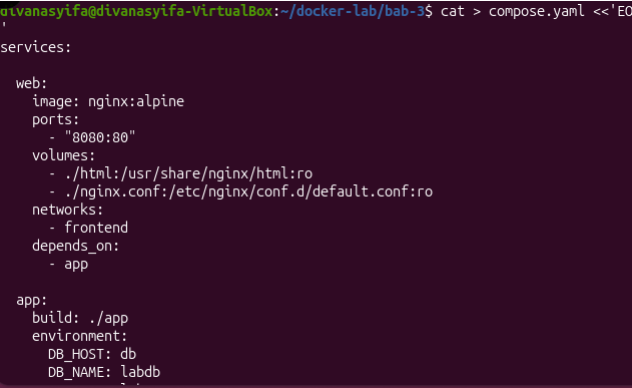

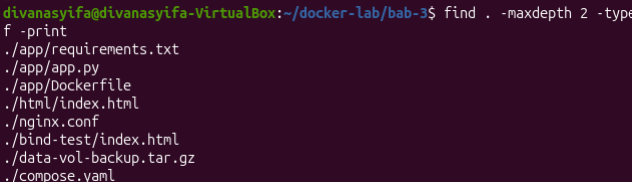

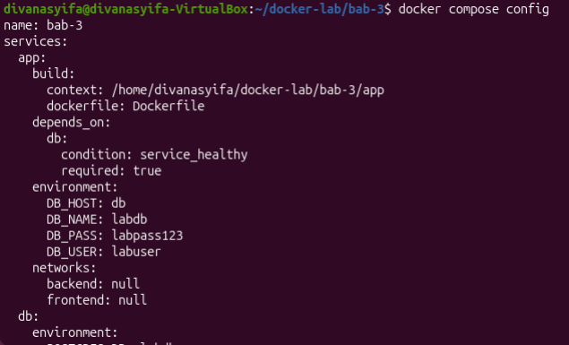

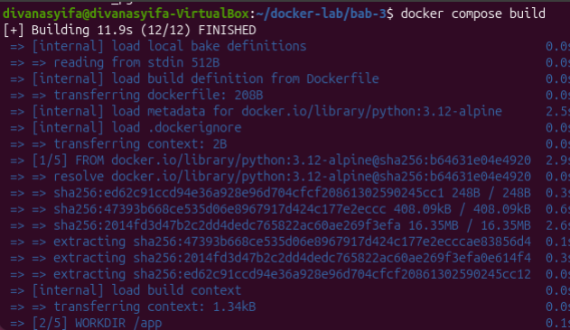

## 2. Jawaban Pertanyaan

**1. Apa perbedaan user-defined bridge dan default bridge?**

User-defined bridge dibuat sendiri oleh pengguna dan menyediakan fitur komunikasi serta resolusi nama container yang lebih baik. Default bridge merupakan network bawaan Docker.

**2. Apa risiko keamanan bind mount?**

Bind mount memberikan container akses langsung terhadap direktori host. Jika direktori sensitif diberikan kepada container, data host dapat berisiko dibaca atau dimodifikasi.

**3. Apa perbedaan `docker compose down` dan `docker compose down -v`?**

`docker compose down` menghapus container dan network tetapi mempertahankan named volume. Sedangkan `docker compose down -v` juga menghapus volume sehingga data yang tersimpan pada volume dapat hilang.

**4. Mengapa menggunakan healthcheck?**

Healthcheck digunakan untuk memastikan PostgreSQL benar-benar siap menerima koneksi sebelum service Flask bergantung kepadanya.

**5. Bagaimana backup database production?**

Backup production sebaiknya dilakukan secara berkala, disimpan pada lokasi berbeda dari server utama, memiliki beberapa versi backup, serta dilakukan pengujian restore secara rutin.

## 3. Kesimpulan

Praktikum Docker Bab 3 berhasil memberikan pemahaman mengenai network, volume, bind mount, tmpfs, dan Docker Compose.

Pengujian network dan volume dapat dilakukan untuk memahami komunikasi antar-container dan persistensi data. Pada Docker Compose, konfigurasi Nginx, Flask, dan PostgreSQL telah dibuat. Namun, proses menjalankan stack mengalami kendala karena kapasitas storage Ubuntu pada VirtualBox telah mencapai 100%.

Kendala tersebut dibuktikan melalui hasil `df -h` dan pesan error PostgreSQL `No space left on device`.

Oleh karena itu, sebelum pengujian Compose dapat diselesaikan, kapasitas storage VM perlu ditambah atau ruang penyimpanan yang tidak diperlukan perlu dibersihkan.
